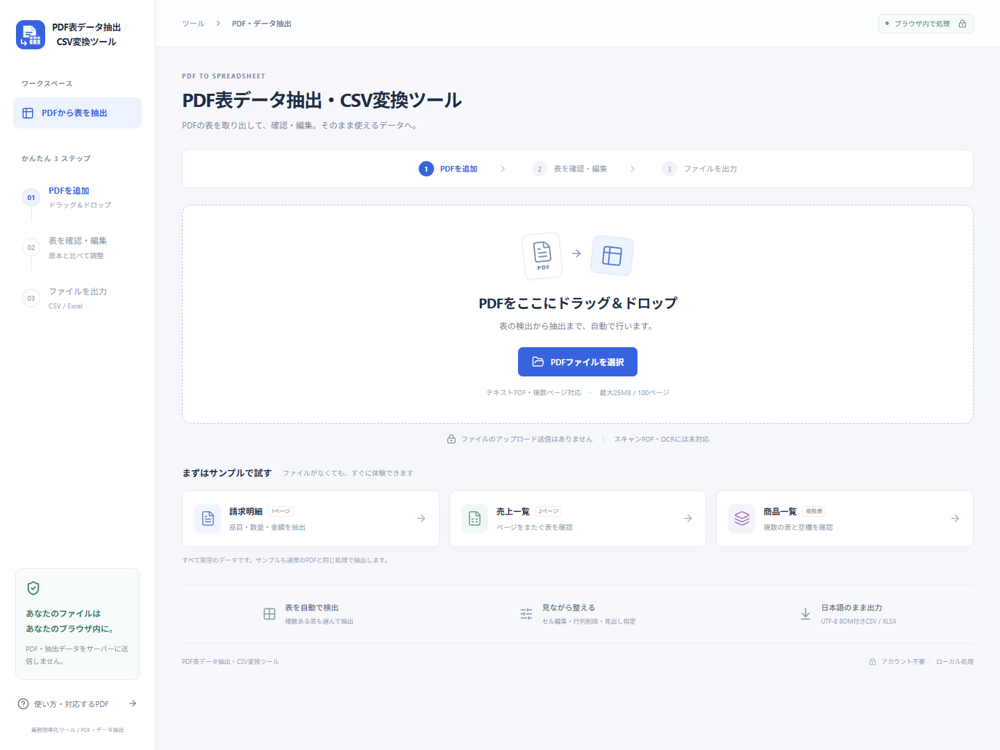
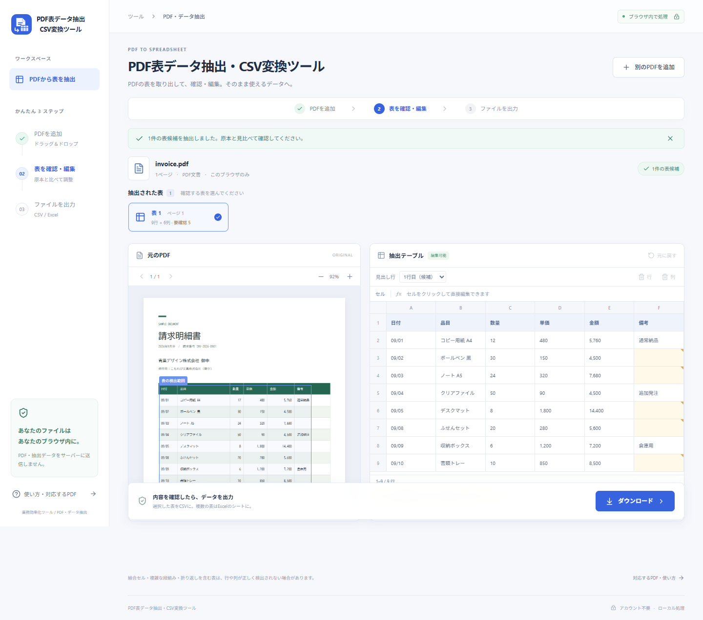
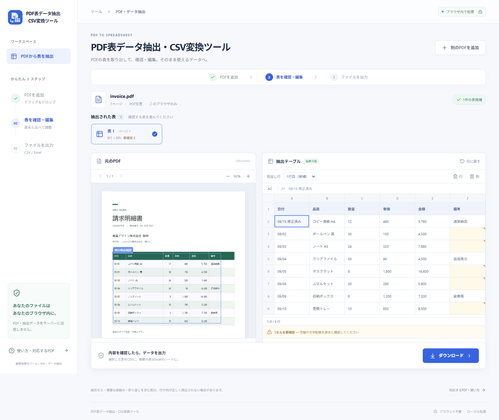
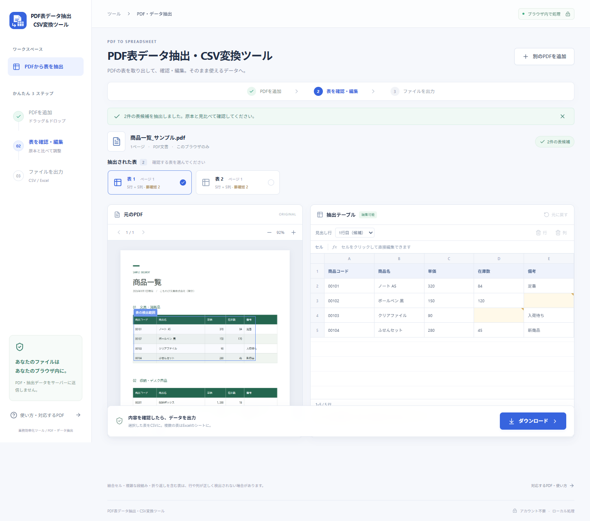

# PDF表データ抽出・CSV変換ツール

PDFに含まれる表を抽出し、原本と比較しながら編集してCSV／XLSXに出力するWebツールです。トップ画面のドロップエリアから、登録なしで作業を始められます。

- **アプリ**: https://pdf-table-extractor-phi.vercel.app
- **ソースコード**: https://github.com/shunsoco-stack/pdf-table-extractor
- **カテゴリ**: 業務効率化ツール
- **サブカテゴリ**: PDF・データ抽出
- **自主制作 / Concept Project**。デモの請求明細・売上一覧・商品一覧はすべて架空のデータです。

## 使い方

1. PDFをドラッグ＆ドロップ、またはファイル選択。サンプルでも体験できます。
2. ページ内の文字位置を解析し、行・列・セル・見出し候補を検出します。
3. 表が複数ある場合は、確認する表を選びます。
4. 左のPDFと右の表を比較。セルを直接編集し、不要な行・列を削除、見出し行を指定します。
5. 内容確認のチェックを入れ、CSVまたはXLSXをダウンロードします。

`Upload → Detect → Extract → Review → Edit → Export`

## 本番スクリーンショット

以下はVercel本番URLから、実際の操作で取得した画面です。画像ファイルはすべて [docs/screenshots](docs/screenshots/) に含まれます。

### 1. PDF Upload



### 2. PDF + Table Preview



### 3. Table編集



### 4. 複数表選択



### 5. Export


## 実装した機能

- **テキストPDF・日本語・複数ページ**。上限25MB、100ページ。
- PDF.jsで文字位置を取得し、行の基準線・連続した文字・列間の余白・位置の反復を用いて表候補を推定。
- ページ内の複数表を選択。ページをまたぐ表はページごとの候補として扱い、自動連結しません。
- 空セルを保持。空欄、重なり、列境界の曖昧さを理由付きで警告。**根拠のない精度パーセントは表示しません**。
- デスクトップではPDF／表の左右比較、スマートフォンでは表示タブ切り替え。
- セル編集、行削除、列削除、見出し指定、最大30操作のUndo。セル移動だけでは履歴を消費しません。
- 大きな表は50行ごとに表示。出力には選択された表の全行を含めます。
- ブラウザ内CSV生成とExcelJSによるXLSX生成。
- PDF + Table + Arrowを組み合わせた専用 [SVGアイコン](public/icon.svg)。
- キーボードフォーカス、ダイアログの名前・フォーカス制御、警告セルの説明、動きを減らす設定に対応。

## 対応範囲と制約

**スキャンPDFのOCRは未対応です。** 文字を選択できるPDFを使用してください。文字のないページはページ番号付きで案内します。パスワード付きPDFは解除したファイルを選択してください。

表検出は幾何情報を使った推定です。結合セル、縦書き、複雑な段組み、折り返し、罫線だけの空行・空列などは正しく復元できない場合があります。位置が整列した文章を表と誤認する場合や表の見落としもあります。警告の有無に関わらず原本を確認してください。完全な精度や帳票形式全般への対応は保証しません。

極端なページ寸法や大量の文字要素には処理上限を設けています。1ページ40,000文字要素、文書合計200,000文字要素、200表、1表100列・5,000行が上限です。上限超過はメッセージを表示して停止します。巨大なPDFは分割して利用してください。

## CSV／XLSXのデータ仕様

| 項目           | CSV                                                             | XLSX                                     |
| -------------- | --------------------------------------------------------------- | ---------------------------------------- |
| 出力対象       | 選択中の1表                                                     | 選択中の表、または全表を各シートへ       |
| 日本語         | UTF-8 BOM付き                                                   | Unicode文字列                            |
| 改行・引用符   | CRLF、カンマ／引用符／改行を適切に引用                          | セル文字列として保存                     |
| 数値・先頭ゼロ | データ文字列は保持。ただしExcel等の自動型推論で変化する場合あり | 全値を文字列で保存し、先頭ゼロを保持     |
| 数式形式の値   | 先頭が `= + - @` 等の値に `'` を付加して式の実行を防止          | 式ではなく文字列として保存               |
| 見出し         | 指定行を先頭へ移動                                              | 指定行を先頭へ移動・書式設定・先頭行固定 |

見出しの前にあった行も削除せず、元の順番で残します。数値計算に用いる場合は、Excel等で内容を確認して型を変換してください。**先頭ゼロの保持が必要ならXLSXを選択してください。**

## Local-first / プライバシー

PDFの読込、文字解析、表編集、CSV／XLSX生成はすべてブラウザ内で行います。ユーザーのPDF・抽出結果をサーバーに送る処理、APIルート、データベース、アクセス解析SDKはありません。

アプリ本体、PDF.js worker／CMaps／標準フォント／WASM、サンプルPDFは同一オリジンから取得します。これらの配信にはネットワーク通信が発生し、ホスティングサービスには通常のHTTPリクエスト情報が届きます。編集データはメモリのみで保持し、ページを閉じる・再読み込みすると消えます。サーバー保存・編集内容の永続保存機能はありません。

## ローカル開発

Node.js 24とnpmを使用します。秘密情報・環境変数の設定は不要です。

```bash
npm ci
npm run dev
```

初期処理でPDF.jsの配信アセットを `public/pdfjs/` へコピーします。このディレクトリは生成物としてGitから除外しています。

```bash
npm run lint
npm run typecheck
npm test
npm run build
npm run secret-scan
npm audit --omit=dev
```

WindowsでネイティブSWCが利用できない場合は、同梱の公式WASM版を使えます。Next.js 16.3.5のローカルWASM解決用設定です。Vercelの通常ビルドでは不要です。

```powershell
$env:NEXT_TEST_WASM_DIR = Join-Path (Get-Location) 'node_modules/@next/swc-wasm-nodejs'
npm run dev -- --webpack --port 3017
# 別ターミナルから npm run test:e2e
```

## 検証

`tests/` に幾何解析の回帰テスト、実PDFをPDF.jsで読み込む統合テスト、日本語出力のテスト、Playwrightの操作テストを収録しています。詳細と結果は [検証記録](docs/verification.md) を参照してください。

| 必須ケース  | 検証内容                                     |
| ----------- | -------------------------------------------- |
| 1ページPDF  | 請求明細を9行×6列へ抽出                      |
| 複数ページ  | 売上一覧2ページから各ページの表を検出        |
| 日本語      | 実PDFの日本語抽出と実出力の読戻し            |
| 複数表      | 商品一覧の同じページの2表を独立検出・選択    |
| 空Cell      | 列位置を保持し、警告付き空欄として編集可能   |
| CSV Export  | BOMバイト列、引用符、改行、編集反映、式対策  |
| XLSX Export | 日本語・先頭ゼロ・空セル・複数シートを読戻し |

ブラウザ検証には通常 `npx playwright install chromium` でブラウザを用意し、別ターミナルで3017番ポートのアプリを起動します。`PLAYWRIGHT_BASE_URL` で検証先を変更できます。

```powershell
$env:PLAYWRIGHT_BASE_URL = 'https://pdf-table-extractor-phi.vercel.app'
$env:CAPTURE_SCREENSHOTS = '1'
npm run test:e2e
```

スクリーンショット保存モードはHTTPS本番URLでのみ有効です。GitHub Web UIでREADMEの全5枚が表示されることも公開時に確認します。

## デモの再生成

```bash
node scripts/generate-demos.mjs
```

初回のみ公式配布元からBIZ UDゴシックを取得してPDFへ埋め込みます。PDFそのものは文字を選択できる形式です。フォントのSIL Open Font Licenseは [public/demos/FONT-LICENSE.txt](public/demos/FONT-LICENSE.txt) に収録しています。アプリ実行時にフォント配布元への通信はありません。

## 技術構成

Next.js App Router / React / TypeScript / PDF.js / ExcelJS / Lucide / Vitest / Playwright / Vercel。Apple Design Skillの指針を取り入れ、即時の操作フィードバック、控えめな階層、Undo、動きを減らす設定、ブラウザ内処理を重視しています。

ソースの秘密情報検査、依存監査、検査の限界は [Secret Scan記録](docs/secret-scan.md) に記載しています。[ポートフォリオ追加用の完全版プロンプト](docs/portfolio-prompt.md) も同梱しています。
